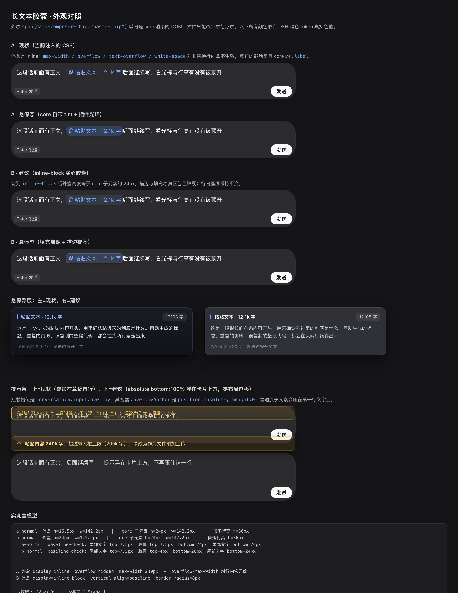

# dsh-paste-chip

把超长粘贴折叠成一张可展开的引用胶囊，避免长草稿把输入框拖死。

- 粘贴阈值：**≥400 字符** 或 **≥12 行** 折叠成一张胶囊
- 外部渠道（标注浏览器 / 划词注释 / 任何调用 API 的插件）：**不看长度，一律成胶囊**
- 上限：**20 万字符**；超过直接拒绝并提示改用附件（超长正文进模型上下文也没有意义）
- 胶囊显示 `粘贴「会议纪要：本周三…」· 1.2k 字`（英文 `Pasted「…」· 1.2k chars`）——带正文前缀，两个同字数的胶囊也能分辨；整块删除、整块撤销
- 发送时展开回完整正文；正文找不到就**明确拦住发送**，绝不把标签当正文发出去



## 为什么需要它

DSH 的输入框每敲一个键都在做全量工作：重算整篇投影、把整段草稿写进 localStorage。草稿一旦到几十万字，就会一卡一顿，极端情况直接把界面拖死。

这个插件把「长文本」从草稿里搬走：

| 没有它 | 有它 |
|---|---|
| 12k 字粘贴后草稿就 12k 字，每键写盘 12k+ | 草稿里只有一张 24px 高的胶囊，每键写盘回到标签大小 |
| 正文和你说的话混在一起，找不着边界 | 正文独立存放，发送时按胶囊所在位置展开 |
| 想确认粘了什么，得在几千字里翻 | 悬停或点击就能看正文前缀与上下文 |

## 为什么不改 core

DSH 的客户端是打包在 `app.asar` 里的，改 core 要连带改 `ElectronAsarIntegrity` 哈希并重签，且下一个版本会被覆盖。本插件只走三条已有公开通道：

| 能力 | 通道 |
|---|---|
| 插入胶囊 | 作用域事件 `slash/input-insert-reference`（内置 slash 插件插 chip 用的就是它） |
| 拿稳定锚点 | `InputActions.captureInsertion()` → 带 `draftRev` 的 `TokenSpan` |
| 发送时展开 | 注册 `InputTriggerSource`，实现 `codec.serialize(ref)` |

正文**不放进 ref id**（core 版把 base64 塞进 ref，中文要放大 4 倍），而是按短 id 存在插件自己的 `localStorage`（前缀 `dsh-paste-chip.v1.`，最多 12 条 / 2MB，超了淘汰最旧的）。草稿里只有一个短 id，每次按键的持久化体积回到标签大小。

## 工作方式

1. 在 `document` 的**捕获阶段**监听 `paste`，只处理本插件所属 composer 的编辑器
2. 短文本直接放行给 core，不干预
3. 长文本：`preventDefault()` → 正文入库 → `actx.bail(...)` 插入胶囊
4. 插入失败：清掉刚写的正文，退回纯文本粘贴并提示——**不吞内容**

## 安装

以本地目录方式装进 profile（路径换成你自己的）：

1. `~/.dsh/profiles/<profile>/package.json` → `dependencies` 加 `"dsh-paste-chip": "link:/path/to/dsh-paste-chip"`
2. 同一个 `package.json` → `dsh.profile.bundles` 数组末尾加 `"dsh-paste-chip"` ← **真正的加载入口**
3. `~/.dsh/profiles/<profile>/cordis.patch.yml` → 末尾加 `- id: dsh-paste-chip`

然后在 profile 目录跑一次 `pnpm install`（需要 Node ≥22.13），再**重启 DSH 客户端**。

宿主启动时按 `dsh.profile.bundles` 的顺序叠 bundle 层，再叠 `cordis.patch.yml`；只加依赖和 patch 行不会加载插件。

> 客户端半的改动刷新页面就会重新加载；宿主半（`lib/index.js`）改了才需要重启。

## 可配置项

全部阈值都能改，两种方式二选一：

**A. cordis.patch.yml**（profile 里那一行加上 config）

```yaml
- id: dsh-paste-chip
  config:
    collapseChars: 600     # 粘贴折叠阈值（字符）
    collapseLines: 15      # 粘贴折叠阈值（行）
    previewChars: 500      # 悬停预览多少字
```

**B. 设置页**（装了 `@deepseek-ai/dsh-settings` 时自动出现「dsh-paste-chip」分区）

| 键 | 默认 | 范围 | 作用 |
|---|---|---|---|
| `collapseChars` | 400 | 100–10000 | 粘贴折叠阈值（字符） |
| `collapseLines` | 12 | 3–200 | 粘贴折叠阈值（行） |
| `maxChars` | 200000 | 1000–2000000 | 单段正文上限，超过拒绝 |
| `externalMinChars` | 8 | 1–200 | 外部渠道插入的兜底长度，低于它视为手打 |
| `warmupMs` | 1200 | 0–10000 | 挂载后预热窗口，期间不接管（防恢复草稿误折叠） |
| `inputGraceMs` | 500 | 0–3000 | 用户输入后的宽限期 |
| `previewChars` | 320 | 80–2000 | 悬停浮层预览字数 |
| `contextChars` | 40 | 0–200 | 悬停浮层上下文各取多少字（0 = 关闭） |
| `hoverDelayMs` | 180 | 0–1000 | 悬停多久弹出预览 |
| `leaveGraceMs` | 60 | 0–1000 | 移出后多久收起 |
| `storeMaxEntries` | 12 | 1–100 | 正文最多存几条，超出淘汰最旧 |
| `storeMaxBytes` | 2097152 | 64KB–8MB | 正文存储总字节上限 |

实现方式：宿主半把这些值汇总到 `GET /api/dsh-paste-chip/config`，客户端启动时读一次并覆盖默认值；读不到就用同一份默认值，越界一律夹到边界（客户端与宿主各夹一次）。默认值写在 `lib/client.js` 的 `DEFAULT_SETTINGS` 与 `lib/index.js` 的 `DEFAULTS`，两边必须保持一致。

## 给其他插件用的主动接法（可选）

默认是**被动接法**：任何插件用 `setDraft` / `insertText` 写进草稿的长文本，都会被差异观察器接住，对方不用改一行代码。

需要更精确控制时（原子插入、草稿里已有胶囊、不想晚一帧），生产者调一行服务：

```js
// 在会话槽组件里：span 必须和当前 revision 一致
const span = props.inputActions.captureInsertion()
const result = ctx.pasteChip.insert(body, { sessionId, span, label: '注释 · 3 条' })
// result: { ok: true, ref, label } | { ok: false, reason }
```

失败原因（都不静默）：`empty`、`too-long`（超 20 万字）、`span-required`（没给 span）、`no-session`（会话 actx 解析不到）、`bail-refused`（插入被拒，正文已清理）。

服务版本：`ctx.pasteChip.version`。

## 非粘贴渠道

标注浏览器、划词询问这类插件是用 `setDraft` / `insertText` 写草稿的，不触发 `paste`，所以另有一条通道：**比对前后两次草稿，认出「这一次新塞进来的那一段」**。

**这条通道没有字数/行数阈值：凡是外部渠道传进来的非空白文本，一律成胶囊。** 粘贴仍保留 400 字阈值（短粘贴保持原文，避免粘个链接也变胶囊）。

怎么区分「外部传进来的」和「用户自己打的」：真实键入一定先触发 `beforeinput`，外部 `setDraft` 不会。所以 `beforeinput` 之后 500ms 内的草稿变化算用户输入，不接管；超出这个窗口且不是用户输入的插入，一律折叠。

三道保护，缺一个都会误伤：

| 保护 | 为什么 |
|---|---|
| 挂载后 1200ms 预热窗口内不接管 | 会话切换/页面加载会"恢复"草稿，那段文本和外部插入长得一模一样 |
| 用户输入事件后 500ms 内不接管 | `beforeinput` / `input` / `keydown` / `compositionstart` / `compositionend` 任一命中都算。只监听 `beforeinput` 不够：输入法组合提交有时不发它，实测漏了 7 次，产出「粘贴文本 · 1 字」这种胶囊 |
| 少于 8 个字的插入不接管 | 误判兜底，不是产品阈值。手打/输入法提交一次就是 1~3 字；真实外部渠道塞的是整段注释。日志里 7 次误折叠全是 1 字 |
| 空白插入不接管 | 纯换行/空格没有折叠价值 |
| 草稿里已有胶囊时跳过 | 有 chip 时 clipboard 偏移与 detect 偏移不再一致，硬插会错位替换 |
| 只处理纯插入（`removed === 0`） | 替换、删除的量算不准，不接管 |

事件：`insertion.detected` / `insertion.collapsed` / `insertion.skip`（带原因）/ `insertion.warmup`。

## 悬停预览

鼠标停在胶囊上，浮层显示「粘贴文本 · 12k 字 · 前 320 字」+ 正文开头，方便确认粘的是什么再发送。

- 定位：胶囊上方，放不下自动翻到下方，并夹在视口内
- 取正文：先用 `props.useInput(s => s).occurrences` 按胶囊序号映射到 `ref`；
  拿不到输入状态时退回「标签 → ref」旁路索引（插入时记录）
- 离开胶囊 / 滚动即隐藏；浮层 `pointer-events: none`，不挡点击
- 事件：`tooltip.show`（带 `via` = occurrences / label / none，以及 `hit`）

## 样式

- **胶囊外圈**：注入一段 `[data-composer-chip="paste-chip"]` 的 CSS——最大宽度 240px、超出省略、圆角、淡蓝描边，悬停时描边加深。内部图标与文字是 core 渲染的，插件只能改外层容器，不做过度覆盖。
- **悬停浮层**：渐变深色卡片 + 8px 毛玻璃、12px 圆角、标题行（竖条 + 标签 + 字数徽标）、等宽正文、底部「仅预览前 N 字 · 发送时展开全文」，120ms 位移淡入。
- **提示条**（超限拒绝/插入失败）：琥珀色左侧强调条，不再是裸内联样式。

## 三种打开方式

| 入口 | 状态 | 说明 |
|---|---|---|
| 悬停胶囊 | 已实现 | 停留 180ms 显示，离开 60ms 收起 |
| **点击胶囊** | 已实现 | 常驻预览：可点「复制全文」，Esc / 点外部关闭；触屏唯一的入口 |
| **工具行「粘贴 N」** | 已实现 | 键盘 Tab 可达；点开列出每条粘贴（标签 + 失效标记），点条目打开常驻预览 |

点击预览走的是 `InputTriggerSource.openReference`：正文命中就接管（返回 `true`），正文已失效则返回 `false` 不抢点击。

托盘是**查看器，不是草稿对象**：不做删除、不做排序——插件没有按条删除胶囊的 API，给了按钮也是假的。

## 悬停预览里的「上下文」

浮层不只有正文前缀，还有一行上下文：

```
…上一句结尾 40 字  ▍此处  下一句开头 40 字…
```

数据来自 `InputState.draft`（clipboard 投影）与 `occurrences[].offset/length`，切片即得；取不到时不渲染这一行。

另外：core 在胶囊上挂了 `title={label}`，会和浮层形成**双 tooltip**，插件在悬停时会把这个 `title` 清掉。

## UX 规格

交互说明见 [docs/UX-SPEC.md](docs/UX-SPEC.md)（页面层级、核心流程、组件三态、状态转移表、文案、字号间距、动效、19 条属性风险表）。可复测的样式对照：[docs/chip-preview.html](docs/chip-preview.html)。

已按规格落地的部分：

| 项 | 改动 | 依据 |
|---|---|---|
| 胶囊外观 | 外层 `display:inline-block`，让 17px 行内盒包住 core 的 24px 内层，收起贴字形的描边；10% 品牌色填充 + 28% 外扩描边（悬停 46%）；同时删掉在 inline 下无效、切 inline-block 后会改基线的 `max-width/overflow/text-overflow/white-space` | 实测基线不动、文字对比度 4.91:1，过 WCAG AA |
| 失效态 | 正文取不到时给胶囊打 `data-paste-chip-lost`，变成琥珀色 | 原来只有发送那一刻才炸 |
| 浮层 | `z-index: 9999 → 60`（低于侧栏 100、高于吸底 7/8）；去掉 `backdrop-filter`；改用 token 颜色与 140ms `cubic-bezier(.16,1,.3,1)` | 长期渐变更融进界面，模糊拖慢首帧 |
| 悬停意图 | 停留 180ms 才显示，离开 60ms 宽限 | 日志里 2.2s 内触发过 7 次，属重复触发 |
| 提示条 | 改为 `absolute; bottom:100%` 浮在卡片上沿，不再压草稿首行；回退（内容没丢）用中性色，只有超限用警告色 | 回退是成功降级，不该报警 |

**仍待人工验证**：`display:inline-block` 在真实 Lexical 里的光标与 IME 行为（盒模型/基线已在无头 Chrome 实测）。若出现光标跳动，回滚只需删掉 `display:inline-block` 这一行——其余样式在 `inline` 下仍然生效。

## 日志

三条路径，各有各的用途：

| 路径 | 谁看 | 内容 |
|---|---|---|
| 浏览器控制台 | 你 | 每条事件一行，带 `[dsh-paste-chip]` 前缀 |
| `window.__dshPasteChip` | 你在 devtools 里查 | 版本、拦截次数、最后一次结果、最近事件数 |
| 落盘 JSONL | **我直接读，不用你转述** | `$DSH_HOME/logs/dsh-paste-chip.log`（默认 `~/.dsh/logs/`） |

客户端在渲染进程里没有文件系统权限，所以它把事件缓冲后批量 `POST /api/dsh-paste-chip/log`，宿主半写盘（`lib/index.js`）。单文件 4MB 轮转一份 `.1`；`DSH_HOME` 不可写时退到临时目录。

事件清单：

| 事件 | 含义 |
|---|---|
| `host.boot` | 宿主半加载了；**文件不存在 = 宿主半根本没加载** |
| `client.loaded` | 客户端半执行了，带版本与三个服务是否可用 |
| `source.registered` / `slot.registered` | 引用来源、槽位挂载成功 |
| `slot.session` | 会话 actx 是否解析到（`actxResolved`） |
| `host.mount` / `scope.resolve` | 组件挂载、编辑器作用域怎么找到的（`self` / `document` / `none`） |
| `paste.seen` | 编辑器里看见了粘帖，带字符数与是否该折叠 |
| `paste.outside-scope` / `paste.no-channel` | 拦错了地方 / 通道缺失 |
| `paste.outcome` | 最终结果：`chip` / `fallback` / `refused` |
| `codec.serialize` / `codec.clipboardText` | 发送时展开正文，带 `hit` 与字符数 |
| `storage.full` | localStorage 配额打满 |
| `window.error` / `window.unhandledrejection` | 未捕获异常 |
| `log.reject` | 客户端日志格式坏了（宿主侧记） |

查法：

```bash
tail -f ~/.dsh/logs/dsh-paste-chip.log            # 追随
grep '"ev":"paste.outcome"' ~/.dsh/logs/dsh-paste-chip.log | tail
grep '"ev":"host.boot"' ~/.dsh/logs/dsh-paste-chip.log   # 宿主到底加载没有
curl -s http://127.0.0.1:<port>/api/dsh-paste-chip/log   # 只读状态：路径与体积
```

## 验证

```bash
node test/harness.mjs   # 15/15：替身 DOM/React/fetch 驱动真实 lib/client.js
node test/host.mjs      #  7/7：真 fs 验证落盘、轮转、坏 JSON 留痕
```

覆盖：阈值边界（1199/1200、19/20 行）、折叠写入与按 ref 取回、插入失败回退纯文本、超限拒绝、DOM 只拦长文本、bail 的 payload 契约、`serialize` 正常展开与缺失时报错、槽位与来源注册。

未验证（需要真机）：胶囊在真实 UI 里的渲染位置与点击行为、与其他插件的 paste 竞争。

## 已知风险

- **`/` 菜单**：为了进 roster 必须注册一个 `trigger: '/'` 的来源，`candidates()` 返回空、`showGroupTitle: false`。理论上不渲染任何行，但没在真机上确认过是否会留下一个空组。
- **作用域事件**：`slash/input-insert-reference` 目前由内置 trigger 插件 bail；第三方插件调用同一条通道在 0.2.1-rc.2 上成立（payload 契约已对齐），但宿主改版可能变。
- **DOM 定位**：优先从自己节点向上找 `[data-lexical-editor]`，找不到退化为页面里第一个 Lexical 编辑器；两者都没有就完全不拦（宁可不生效，也不误伤别的输入区）。

## 卸载

删掉上面三处（依赖 / `dsh.profile.bundles` 条目 / `cordis.patch.yml` 行），`pnpm install`，重启客户端。草稿里残留的胶囊会变成失效态（正文仍在 `localStorage` 的 `dsh-paste-chip.v1.*` 下，可手动清理）。

## 目录

```
lib/index.js      宿主半（空实现）
lib/client.js     客户端半：拦截、存储、胶囊、展开
cordis.patch.yml  插件挂载声明
test/harness.mjs  客户端逻辑离线验证
test/host.mjs     宿主半落盘验证
docs/UX-SPEC.md   UX 交互说明（层级 / 流程 / 三态 / 文案 / CSS 规格）
docs/chip-preview.html  样式对照页（可复测）
```
