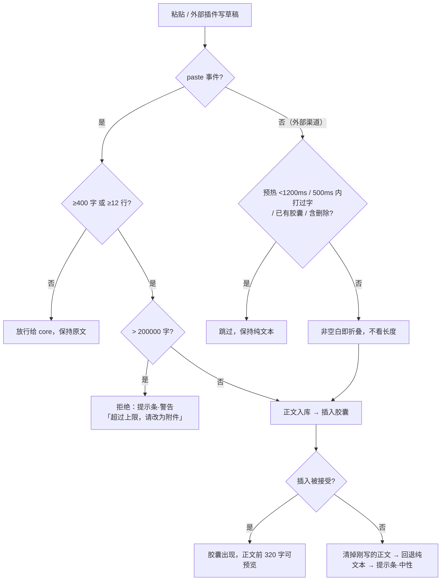
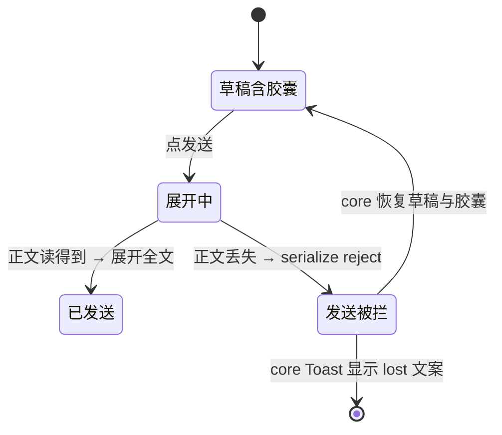

# 长文本粘贴胶囊 · UX 交互说明（可执行版）

> 适用对象：`dsh-paste-chip` v0.1.10（插件侧）。core 只读参考
> `packages/client/ui-conversation/src/client/input/editor/`。
> 本文不改变任何既有语义（阈值、拒绝、回退、发送展开全部保留），只把「长什么样、什么时候出现、出现在哪一层、出问题怎么说」定死。

## 0. 证据等级与已核实事实

| 结论 | 等级 | 依据 |
|---|---|---|
| 胶囊外层是 `span[data-composer-chip="paste-chip"]`（`contenteditable=false`），内部是 core 渲染的 `span.reference.chip`（图标 + 截断标签） | 已验证 | `chip-node.tsx:119-124`、`ReferenceChip.tsx`、`ReferenceChip.module.css` |
| 外层盒子现在只有 **17px 高**，core 内层是 **24px 高** —— 描边/填充贴的是文字框，不是胶囊 | 已验证 | 无头 Chrome 实测：`外盒 h=17px / 内层 h=24px`（见 `docs/chip-preview.html`） |
| 外层改为 `inline-block` 后高度 24px，且**尾部文字基线一字未动**（`top=7px / bottom=24px` 与现状完全一致） | 已验证 | 同上，baseline-check 行 |
| 现状 `max-width` / `overflow` / `text-overflow` 写在行内盒上**不生效**，截断实际来自 core 的 `.label` | 已验证 | CSS 规范（这些属性不适用于非替换行内盒）+ 实测 `overflow=hidden, maxWidth=240px` 仍 h=17px |
| 胶囊文字 `#7aaaff` 在卡片底 `#2c2c2e` 上对比度 **5.99:1**；加 11% 蓝填充后 **4.91:1**（仍过 AA） | 已验证 | 页内按合成色实算（`docs/chip-preview.html` 度量区） |
| 悬停浮层每次鼠标进入胶囊会被重复触发：**2.2 秒内 7 次 `tooltip.show`**（`15:39:10.114/.117` 三连发） | 已验证 | `~/.dsh/logs/dsh-paste-chip.log` |
| 提示条挂在 `conversation.input.overlay`，容器 `.overlayAnchor` 是 `position:absolute; inset:0 0 auto; height:0` → 普通流子元素**压在草稿首行上** | 已验证 | `InputBar.tsx:404` + `InputBar.module.css:118-122` + 截图 |
| 发送失败时 core **拦截发送、恢复草稿与胶囊**，并通过自己的 notices 展示错误文案 | 已验证 | `ui-conversation/tests/input-reference-submit.client.spec.ts:128-155` |
| 胶囊整体删除 / 整块撤销 | 声称 | README；`isKeyboardSelectable()===false` 只证明了「方向键一步跨过、退格整块删」，undo 未实测 |

## 1. 页面层级：谁在谁之上、谁被谁裁掉

### 1.1 层级表

| # | 元素 | position | z-index | 被谁裁剪 | 备注 |
|---|---|---|---|---|---|
| 1 | 草稿文字 | static | auto | `.scroll` | 唯一滚动容器 |
| 2 | **胶囊** `span[data-composer-chip]` | inline-block（建议） | **auto，禁止设** | `.scroll` | 与文字同层，靠 DOM 顺序 |
| 3 | **提示条** `div[data-dsh-paste-chip="notice"]` | absolute（必须自定位） | 2（仅卡片内有效） | 卡片不裁剪 | 现挂 `.overlayAnchor` 内 |
| 4 | core Toast（发送失败） | 由 core 定 | 由 core 定 | 由 core 定 | 不与我们竞争 |
| 5 | **悬停浮层** `div[data-dsh-paste-chip="tooltip"]` | **fixed，挂 body** | **60**（现状 9999） | 无 | `pointer-events:none` |

### 1.2 z-index 取值依据（core 现状，已验证）

```
toBottom 悬浮按钮 8   >   吸底 composer 7   >   正文
侧栏文档预览 100 · onboarding 900 · 平台级浮层 1001
```

- 浮层必须 **> 8**（否则被「回到底部」按钮和吸底卡片压住）。
- 浮层应 **< 100**：它只是输入框的附属说明，不该盖住侧栏预览和设置弹窗。现状 `9999` 会盖住一切，属于越权层级。
- 提示条**不要单独抬高 z-index**：它在卡片内部，超出卡片的 z-index 没有意义，只会误伤同层菜单。

### 1.3 裁剪链（决定了浮层只能 fixed）

```
.card  radius 28px，overflow 可见  →  不裁剪
  └─ .scroll  overflow-y:auto       →  ！裁剪所有后代（含 absolute 子孙）
       └─ .input  overflow 可见     →  不裁剪
            └─ 胶囊（行内盒）
```

**结论**：胶囊不能自带绝对定位浮层（会被 `.scroll` 切掉），浮层必须 `position:fixed` 挂到 `body`；这也解释了为什么滚动时要立即隐藏浮层（锚点会移出视口）。现状缺 `resize` 监听 → 窗口尺寸变化后浮层会脱离锚点，建议一并补上。

## 2. 核心操作流程

### 2.1 粘贴折叠（含外部渠道写入）



### 2.2 悬停预览

```
指针进入胶囊（须 180ms 悬停意图，见 §4.5）
  → 取正文：occurrences 按序映射 ref；拿不到退「标签→ref」索引
  → 命中：浮层出现在胶囊上方 10px；上方不够翻到下方；水平夹在视口内
  → 未命中（正文已被清理）：现在什么都不显示 ← 建议改为「失效态」提示（§3.2）
指针离开胶囊 / 滚动 / resize → 90ms 淡出
```

### 2.3 删除与撤销

| 操作 | 结果 | 来源 |
|---|---|---|
| `Backspace` / `Delete` 紧邻胶囊 | 整块删除（一个原子节点） | 已验证：`isKeyboardSelectable()===false` |
| `←` / `→` 经过胶囊 | 一步跨过，不停在胶囊内部 | 同上 |
| `Ctrl/⌘ + Z` | 整块恢复 | 声称（README，未实测） |
| 选中跨胶囊复制 | 剪贴板拿到的是**标签文本**（`粘贴文本 · 12.1k 字`），不是正文 | 已验证：`clipboardText: label` + `getTextContent()` |

> ⚠️ 「复制得到标签而不是正文」是一个真实的预期落差。建议至少在浮层脚注里点明（§4.2 `tip.copyHint`），否则用户会以为复制到了内容。

### 2.4 发送（成功 / 失败）



**关键：发送失败不归插件的提示条管。** core 会拦截提交、把草稿和胶囊原样恢复，并用它自己的 Toast 通道显示我们 reject 的文案。插件不要在这条路径上再弹一条自己的提示（会双提示、且位置冲突）。

## 3. 关键组件清单 × 三态

### 3.1 胶囊 `span[data-composer-chip="paste-chip"]`

| 态 | 触发 | 呈现 | 现状 → 建议 |
|---|---|---|---|
| 加载 | — | 不存在。插入是同步的，没有骨架态 | 无变化 |
| 空白 | 文本为空 / 纯空白 | **永不出现**（空文本不进 `shouldCollapse`，外部渠道也排除 `trim()===""`） | 无变化 |
| 错误 | ①插入被拒 → 根本没胶囊（回退纯文本）②正文已被清理 → 胶囊仍在但展开失败 | ①提示条·中性 ②建议：外环换警告色 + 悬停给失效说明 | ②现在**没有任何视觉区别**，只在发送时才炸 → 需补 |

### 3.2 悬停浮层 `div[data-dsh-paste-chip="tooltip"]`

| 态 | 触发 | 呈现 |
|---|---|---|
| 加载 | 首次悬停 | 同步读一次存储，无骨架、无 loading 文案 |
| 空白 | 正文读不到（`readBody===null`） | 现状：**不显示**。建议：显示失效态（标题 + 一句 lost 文案 + 重新粘贴指引） |
| 错误 | 正文为空串（存储被外部改成 `""`） | 与「空白」合并处理，不显示 0 字正文 |

### 3.3 提示条 `div[data-dsh-paste-chip="notice"]`（`role="alert"`）

| 态 | 触发 | 语气 | 文案 |
|---|---|---|---|
| 加载 | — | — | 无（同步 setState） |
| 空白 | 无告警 | 不渲染（`notice===null` → 返回 `null`） | — |
| 错误·拒绝 | 粘贴 > 20 万字 | **警告（琥珀）** | `粘贴内容 240k 字，超过输入框上限（200k 字）；请改为作为文件附加上传` |
| 错误·回退 | 胶囊插入失败 | **中性（灰）**——内容没丢，不该报警 | `胶囊插入失败，已按纯文本粘贴` |
| 错误·失效 | 发送时正文丢失 | **不接管**，交给 core Toast | 复用 `lost` 文案 |

> 现状两种错误都用琥珀警告色。回退是「已降级成功」，用警告色会让用户以为内容没了 —— 这是本次要改的语气问题。

### 3.4 发送中的胶囊

胶囊不可点、无 loading。发送忙碌态由 core 的卡片态负责，插件不叠加任何动效。

## 4. 开发可执行的交互说明

### 4.1 状态转移表（胶囊 + 浮层）

| 当前 | 事件 | 下一个 | 副作用 |
|---|---|---|---|
| 无胶囊 | 粘贴 ≥阈值且 ≤上限 | 胶囊(正常) | 正文入库、写 `label→ref` 索引 |
| 无胶囊 | 粘贴 > 上限 | 无胶囊 + 提示条(警告) | 不写库 |
| 无胶囊 | 插入被拒 | 无胶囊 + 提示条(中性) | 立即 `dropBody`，不留孤儿 |
| 胶囊(正常) | 指针进入 ≥180ms | 浮层(可见) | 位置计算一次、DOM 复用 |
| 浮层(可见) | 指针离开 / 滚动 / resize | 浮层(淡出) | 90ms 后 `opacity:0` |
| 胶囊(正常) | 正文被清理后悬停 | 胶囊(失效) + 浮层(失效) | 只算一次，不重复渲染 |
| 胶囊(任意) | 退格 / 删除 | 无胶囊 | — |
| 胶囊(任意) | 发送 且 正文在 | 已发送 | 展开全文 |
| 胶囊(任意) | 发送 且 正文丢失 | 草稿不变 + core Toast | 插件不弹提示条 |

### 4.2 文案（中 / 英）

| key | zh | en |
|---|---|---|
| `label` | `粘贴文本 · {n} 字` | `Pasted text · {n} chars` |
| `tooLong` | `粘贴内容 {n} 字，超过输入框上限（200k 字）；请改为作为文件附加上传` | `Pasted {n} chars, over the composer limit (200k); attach it as a file instead` |
| `failed` | `胶囊插入失败，已按纯文本粘贴` | `Could not insert the chip; pasted as plain text` |
| `lost` | `这段粘贴的正文已失效（可能清理过缓存），请重新粘贴` | `This paste's body is gone (storage pruned); paste it again` |
| `tip.truncated` | `仅预览前 320 字 · 发送时展开全文` | `First 320 chars only · expands on send` |
| `tip.full` | `发送时展开全文` | `Expands on send` |
| `tip.copyHint`（新增） | `复制此胶囊只会得到标签文字` | `Copying this chip yields the label, not the text` |
| `tip.lostTitle`（新增） | `正文已失效` | `Body unavailable` |

数字统一走 `compactCount`：`980` / `1.2k` / `200k`。

### 4.3 字号与间距刻度

| 用途 | 字号 / 行高 | 说明 |
|---|---|---|
| 胶囊标签 | 继承输入框 **14px / 24px**（不可改，改了会顶开行高） | core 决定 |
| 浮层标题 | 12px / 18px，600 | 与正文同号但加粗 |
| 浮层正文 | 12px / 19.4px（`1.62`），等宽 | `ui-monospace` |
| 浮层角标（字数） | 11px / 16px | 胶囊形，`padding: 1px 7px` |
| 浮层脚注 | 11px / 16px | 45% 透明度 |
| 提示条 | 12px / 18px | 与 core `.notice` 一致 |

间距只用 **2 / 4 / 6 / 8 / 12 / 16**：浮层内 `padding 12px 14px`、块间距 8px；胶囊描边靠 `box-shadow`，不占位。

### 4.4 颜色 token（暗色为准，全部取 core 真值）

| 语义 | token | 暗色值 | 用途 |
|---|---|---|---|
| 品牌主色 | `--dsw-alias-state-business-primary` | `rgb(122,170,255)` | 胶囊描边、浮层强调条 |
| 品牌悬停底 | `--dsw-alias-state-business-tertiary` | `rgb(52,65,91)` | core 自带 hover 底（不要覆盖） |
| 卡片底 | `--dsw-specific-input-major` | `rgb(44,44,46)` | 浮层底色从它派生 |
| 主文字 | `--dsw-alias-label-primary` | `rgb(249,250,251)` | 浮层标题 |
| 次文字 | `--dsw-alias-label-secondary` | `rgb(207,211,214)` | 浮层正文、提示条正文 |
| 三级文字 | `--dsw-alias-label-tertiary` | `rgb(173,178,184)` | 脚注 |
| 描边 | `--dsw-alias-border-l2` | `rgba(255,255,255,0.12)` | 提示条边框 |
| 警告 | 自持 `#f2c14e` / `rgba(210,153,34,*)` | — | 仅「拒绝」用 |

> **必须改用 token 的地方**：现状把 `rgba(122,162,255,…)` 写死。这个值只对暗色成立，亮色主题的品牌色是 `rgb(65,118,230)`，写死会在白底上发灰发虚。

### 4.5 动效

| 对象 | 属性 | 时长 | 缓动 | 备注 |
|---|---|---|---|---|
| 胶囊 悬停 | `background-color, box-shadow` | 120ms | `ease-out` | 只动颜色与阴影 |
| 浮层 出现 | `opacity, translateY(2px→0)` | 140ms | `cubic-bezier(.16,1,.3,1)` | 先算位置再显示，避免闪左右 |
| 浮层 消失 | `opacity` | 90ms | `ease-in` | 比出现快 |
| **悬停意图** | 延迟显示 | **180ms** | — | 修掉 2.2s/7 次的重复触发 |
| 离开宽限 | 延迟隐藏 | 60ms | — | 在图标与文字间移动不闪 |
| 提示条 进入 | `opacity, translateY(-4px→0)` | 160ms | `ease-out` | 从卡片上沿滑入 |
| 提示条 自动消失 | 停留 **6s** 后淡出 240ms | — | — | 建议新增；现状永不消失 |
| 全部 | `prefers-reduced-motion: reduce` | 0ms | — | 关闭所有位移，只留透明度 |

**禁止**在胶囊上用 `transform: scale()`：`inline-block` 下会创建层叠上下文，缩放时还会和光标重绘打架，视觉收益远小于风险。

## 5. 胶囊外观：可直接落地的 CSS

> 作用域严格限定在 `span[data-composer-chip="paste-chip"]`（外层）与插件自有 DOM。**不要**用后代选择器去改 core 内层：CSS Modules 的类名是哈希的（`.chip` / `.reference` 编译后不可依赖），唯一通用的 `outer > span` 也随时可能被 core 的结构调整打断。

### 5.1 建议 CSS（替换 `ensureStyles()` 里 `[data-composer-chip]` 两段）

```css
[data-composer-chip="paste-chip"] {
  /* 关键：让外盒真正包住 core 的 24px inline-flex 子元素。
     行内盒只有 17px 高，描边会贴着字形，看起来不像胶囊。 */
  display: inline-block;
  vertical-align: baseline;          /* 与文字基线对齐，实测文本位置不变 */
  max-width: 100%;                   /* 收窄交给内部 label，外盒不再重复约束 */
  border-radius: var(--dsw-radius-sm, 8px);

  /* 填充：只提供「物体感」，可辨识度交给描边 */
  background-color: rgba(122, 170, 255, 0.10);                     /* 兜底 */
  background-color: color-mix(in srgb,
    var(--dsw-alias-state-business-primary, #7aaaff) 10%, transparent);

  /* 描边/阴影一律走 box-shadow：不占位，不会推宽、不会移动光标 */
  box-shadow:
    0 0 0 1px rgba(122, 170, 255, 0.28),                           /* 兜底 */
    0 1px 2px rgba(0, 0, 0, 0.22);
  box-shadow:
    0 0 0 1px color-mix(in srgb,
      var(--dsw-alias-state-business-primary, #7aaaff) 28%, transparent),
    0 1px 2px rgba(0, 0, 0, 0.22);

  transition: background-color 120ms ease-out, box-shadow 120ms ease-out;
}

[data-composer-chip="paste-chip"]:hover {
  background-color: color-mix(in srgb,
    var(--dsw-alias-state-business-primary, #7aaaff) 16%, transparent);
  box-shadow:
    0 0 0 1px color-mix(in srgb,
      var(--dsw-alias-state-business-primary, #7aaaff) 46%, transparent),
    0 2px 6px rgba(0, 0, 0, 0.26);
}

/* 正文已失效：仍然是一张胶囊，但一眼看出不对劲 */
[data-composer-chip="paste-chip"][data-paste-chip-lost] {
  background-color: color-mix(in srgb, #f2c14e 10%, transparent);
  box-shadow: 0 0 0 1px color-mix(in srgb, #f2c14e 40%, transparent),
              0 1px 2px rgba(0, 0, 0, 0.22);
}

@media (prefers-reduced-motion: reduce) {
  [data-composer-chip="paste-chip"] { transition: none; }
}
```

要点：

1. **必须同时删掉现状里的 `max-width:240px; overflow:hidden; text-overflow:ellipsis; white-space:nowrap;`**。它们在 `display:inline` 下本来就不生效（所以现状没问题）；一旦切到 `inline-block`，`overflow` 生效会把 inline-block 的基线规则变成「底边对齐」（`overflow != visible` 时基线取底边），文字会整体下沉 —— 这是最容易踩的一脚。
2. 描边用 `0 0 0 1px`（外扩）而不是 `inset`：core 的 hover 底色会盖住盒子内部，inset 描边在悬停时会消失。
3. 填充 10% 是实测后的安全值：文字/填充底 **4.91:1**，仍过 AA；填充/卡片底 **1.22:1**，够看出边界又不抢眼。

### 5.2 属性风险表

| 属性 | 风险 | 说明 |
|---|---|---|
| `display: inline-block` | 🟡 中 | 唯一能做出真胶囊的开关；实测不移动基线、不改行高，但会**激活**此前无效的 `overflow / max-width / padding` 等属性 |
| `background-color` | 🟢 低 | 不占位；悬停时被 core 内层 tint 覆盖（这是预期） |
| `box-shadow` | 🟢 低 | 不占位；行内/行内块都安全，胶囊描边的正确姿势 |
| `border-radius` | 🟢 低 | 不占位；只影响背景与阴影的裁剪 |
| `transition` | 🟢 低 | — |
| `outline` | 🟢 低 | 不占位，但会和 focus 样式打架，非必要不用 |
| `color` | ⚪ 无效 | 内层 `.chip` 自带 `color`，外层设了不生效 |
| `max-width` / `width` | ⚪ 无效（inline） | 切 `inline-block` 后生效，会与内层 240px 双重约束，务必设 `100%` |
| `overflow` | 🔴 无效 + 陷阱 | `inline` 下无效；`inline-block` 下生效并**改基线**，直接导致文字下沉 |
| `text-overflow` / `white-space` | ⚪ 无效 | 截断由内层 `.label` 完成，外层写了也没用 |
| `padding` / `margin` | 🔴 高 | 占位：改变胶囊宽度、折行位置、光标 x 坐标；还会让内层 hover 底与描边错位 |
| `border` | 🟠 中高 | 占位，1px 会把胶囊推宽 2px 并挤动相邻文字 |
| `font-size` / `line-height` / `font-weight` / `letter-spacing` | 🔴 高 | 直接改行高与基线，输入框整体高度会跳 |
| `vertical-align` | 🔴 高 | 立刻移动基线；除非实测过，一律保持 `baseline` |
| `position: relative` | 🟠 中 | 会改变层叠与光标几何；不需要 |
| `position: absolute` / 内部浮层 | 🔴 高 | 会被 `.scroll` 裁掉，浮层必须 fixed 挂 body |
| `transform` / `scale` | 🟠 中 | `inline` 上无效（容易误判成「没生效」），`inline-block` 上生效并创建层叠上下文 |
| `opacity` / `filter` | 🟠 中 | 作用于整个子树（含文字），且创建层叠上下文 |
| 后代选择器改内层 | 🔴 高 | 类名是 CSS Modules 哈希，随时断；`outer > span` 同样脆弱 |
| 给胶囊设 `z-index` | 🔴 高 | 行内盒不参与，行内块会自成层叠上下文，可能压住菜单 |

### 5.3 浮层与提示条（自有 DOM，可自由设计）

**浮层**：底部继承卡片色（比现状的深蓝渐变更融进界面），描边用 0.5px 硬边，`z-index: 60`；`pointer-events: none` 保持；`backdrop-filter` 建议去掉（半透明渐变已经能出层次，模糊在长文本上只会拖慢首帧）。

```css
[data-dsh-paste-chip="tooltip"] {
  position: fixed;
  z-index: 60;                       /* 修：> 吸底 7 / 回到底部 8，< 侧栏 100 */
  width: 520px;
  max-width: min(520px, calc(100vw - 32px));
  max-height: 320px;
  overflow: hidden;
  padding: 12px 14px;
  border-radius: var(--dsw-radius-md, 12px);
  background: color-mix(in srgb, var(--dsw-specific-input-major, #2c2c2e) 96%,
                        var(--dsw-alias-state-business-primary, #7aaaff));
  border: 1px solid rgba(255, 255, 255, 0.10);
  box-shadow: 0 12px 28px rgba(0, 0, 0, 0.45), 0 0 0 0.5px rgba(0, 0, 0, 0.5);
  color: var(--dsw-alias-label-secondary, #cfd3d6);
  font-size: 12px;
  line-height: 18px;
  pointer-events: none;
  opacity: 0;
  transform: translateY(2px);
  transition: opacity 140ms cubic-bezier(0.16, 1, 0.3, 1),
              transform 140ms cubic-bezier(0.16, 1, 0.3, 1);
}
```

**提示条**：修掉「压在首行」的问题——在 `.overlayAnchor`（`position:absolute; height:0`）里自定位到卡片上方，与 core Toast / `.notice` 的落位保持一致，且不改变卡片高度（不推挤发送按钮）。

```css
[data-dsh-paste-chip="notice"] {
  position: absolute;
  bottom: 100%;                      /* 修：浮在卡片上沿，不再压住草稿首行 */
  left: 0;
  right: 0;
  margin-bottom: 6px;
  z-index: 2;
  padding: 8px 12px;
  border-radius: var(--dsw-radius-sm, 8px);
  font-size: 12px;
  line-height: 18px;
  color: var(--dsw-alias-label-secondary, #cfd3d6);
  background: color-mix(in srgb, var(--dsw-specific-input-major, #2c2c2e) 92%,
                        var(--dsw-alias-border-l2, rgba(255,255,255,0.12)));
  box-shadow: 0 8px 20px rgba(0, 0, 0, 0.35);
  animation: dsh-paste-chip-notice-in 160ms ease-out;
}

/* 只有「拒绝」才用警告色；「回退」是成功降级，用中性色 */
[data-dsh-paste-chip="notice"][data-tone="warn"] {
  color: #f5d08a;
  background: rgba(210, 153, 34, 0.13);
  border: 1px solid rgba(210, 153, 34, 0.28);
}

@keyframes dsh-paste-chip-notice-in {
  from { opacity: 0; transform: translateY(4px); }
  to   { opacity: 1; transform: translateY(0); }
}
```

## 6. 落地顺序（改一处验一处）

1. 单人最省事的验证面：`ensureStyles()` 换成 §5.1，**同时删掉** `max-width/overflow/text-overflow/white-space` 四行 → 打开发送框、粘一段 12108 字的文本，确认胶囊变高、文字不下沉、光标能正常进出。
2. 浮层 `z-index: 9999 → 60`，补 180ms 悬停意图 + 60ms 离开宽限 + `resize` 监听。验法：在胶囊上来回扫 3 秒，日志里 `tooltip.show` 应从 7 次降到 1 次。
3. 提示条改 `position: absolute; bottom: 100%`，并把 `failed` 的语气切到中性。验法：断掉 `inputActions` 造一次插入失败，看提示是否浮在卡片上方、不压字。
4. `lost` 态：`readBody` 返回 `null` 时给胶囊打 `data-paste-chip-lost`，悬停走失效文案。验法：devtools 删掉 `localStorage` 里对应 `dsh-paste-chip.v1.<id>`，再悬停。

## 7. 未覆盖 / 需人工确认

| 项 | 状态 | 怎么补 |
|---|---|---|
| `inline-block` 在**真实 Lexical 编辑器**里的光标行为（胶囊两侧插入、选区块、IME 组合） | 未覆盖 | 只能进真实 DSH 输入框手测：胶囊前后各点一次、方向键跨越、跨胶囊选删、中文输入法在胶囊后连打 |
| `Ctrl/⌘+Z` 是否整块恢复胶囊 | 声称 | 同上，删除后立刻撤销 |
| core Toast 的确切落位（是否与提示条抢占同一区域） | 未覆盖 | core 源码只看到 `anchor={cardRef.current}`，实际位置需在真实界面触发一次发送失败 |
| 亮色主题观感 | 未覆盖 | 本文颜色全部走 token，理论上自适配；建议切亮色截一张图 |
| 多胶囊相邻 / 连续两行胶囊的视觉拥挤 | 未覆盖 | 胶囊高 24px = 行高 24px，两行相邻会贴边；若真实界面觉得挤，改用 `background-size: 100% 20px; background-position: center; background-repeat: no-repeat` 把填充收窄 2px（不占位） |

---

附：实测对照页 `docs/chip-preview.html`（无头 Chrome 打开即可复测盒模型与对比度），截图 `docs/chip-preview.png`。
